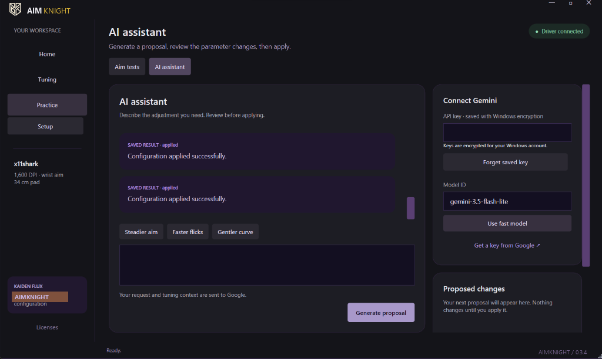

  

<h1 align="center">AimKnight</h1>

  <b>A modern Windows mouse acceleration configuration tool with aim practice and an AI-powered curve tuning assistant.</b>

  
  
  
  
  

  

---

## 🌟 What Makes AimKnight Unique

Most mouse acceleration software requires manual tweaking of complex mathematical formulas and numeric parameters. **AimKnight introduces an intelligent AI Tuning Assistant powered by the Google Gemini API** to solve this problem:

- 🎯 **Natural-Language Curve Tuning**: Instead of guessing exponents and offsets, simply describe what you need (e.g., *"Steadier aim"*, *"Faster flicks"*, *"Keep micro-adjustments slow in Valorant at 1600 DPI"*).
- 🤖 **Gemini API Integration**: The app sends your current setup (DPI, mousepad size, sensitivity, game profile) to Google Gemini and returns a tailored acceleration curve proposal.
- 🔐 **Windows DPAPI Encryption**: Your Gemini API key is encrypted locally using the Windows Data Protection API (`System.Security.Cryptography.ProtectedData`). Keys are never saved in plaintext.
- 🛡️ **Safety & Parameter Validation**: Proposals are strictly validated on the client side using JSON schema verification. The AI cannot modify protected driver settings or kernel files — only valid curve parameters are proposed.
- 📊 **Visual Diff & Undo**: Review proposed curve changes side-by-side with your active settings before applying them to the driver, with one-click Undo support.

---

## 🚀 Core Features

### 1. AI Tuning Assistant
- **Quick Preset Prompts**: One-click prompt triggers for *"Steadier aim"*, *"Faster flicks"*, and *"Gentler curve"*.
- **Multi-Model Support**: Defaults to fast response models like `gemini-3.5-flash-lite` or custom Gemini model endpoints.
- **Local Tuning Memory**: Keeps track of recent tuning requests and applied adjustments locally.

### 2. Native Acceleration Curve Controls
- **6 Curve Modes**: Linear, Classic, Natural, Power, Jump, and Synchronous.
- **Full Parameter Control**: Input/output offsets, acceleration rates, decay, motivity, gain/velocity, and output caps.
- **Independent Axis Scaling**: Separate horizontal and vertical axis multiplier options.

### 3. Aim Practice & Testing
- Integrated aim tests with high-resolution timing to test flick accuracy, tracking, and reaction speed before taking curves into competitive games.

### 4. Game Profiles & Sensitivity Calculator
- Per-game acceleration profiles for titles like *Valorant*, *CS2*, *Apex Legends*, and *Overwatch*.
- Built-in sensitivity conversion calculator.

---

## 🛠️ Architecture & Tech Stack

| Component | Technology | Description |
|---|---|---|
| **Frontend UI** | **WPF (XAML) & WinForms** | Modern dark-themed dashboard, interactive charts, and responsive sidebar navigation |
| **Language** | **C# 7.3+ / .NET Framework 4.7.2** | Core application logic, event-driven UI, async API orchestration |
| **AI Integration** | **Google Gemini REST API** | Asynchronous HTTP client requesting structured JSON tuning proposals |
| **Security** | **Windows DPAPI** | Hardware/user-bound encrypted API key storage |
| **Low-Level Driver** | **C++ / Raw Accel Driver** | Kernel-level raw mouse input acceleration via signed Windows driver |
| **Data Serialisation** | **Newtonsoft.Json** | Atomic JSON persistence for profiles, curves, and settings |

---

## 📦 Getting Started

### Prerequisites
- Windows 10 or Windows 11 (64-bit)
- .NET Framework 4.7.2 or newer

### Installation
1. Download the latest release from the repository.
2. Extract the complete archive into a dedicated folder.
3. Launch `AimKnight.exe` (keep `writer.exe` and companion DLLs in the same directory).
4. *(Optional)* Go to the **AI Assistant** tab, enter your Gemini API key, and begin tuning your curves.

---

## 🔒 Security & Privacy

- **No Plaintext Keys**: Your API key is encrypted using Windows DPAPI and stored in `%LOCALAPPDATA%\AimKnight\`. It cannot be decrypted by other Windows user accounts.
- **Strict Validation**: All parameter proposals from the AI pass through local boundary checks before they can be previewed or applied to the kernel driver.

---

## 📄 Licence

This project is licensed under the MIT Licence — see the [LICENSE](LICENSE) file for details.  
Includes components from the open-source Raw Accel driver (MIT) and Newtonsoft.Json.

---

  <b>Developed by <a href="https://black-knight21.github.io/Black-knight/">Black Knight</a></b>

